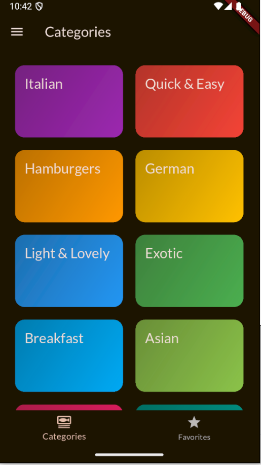
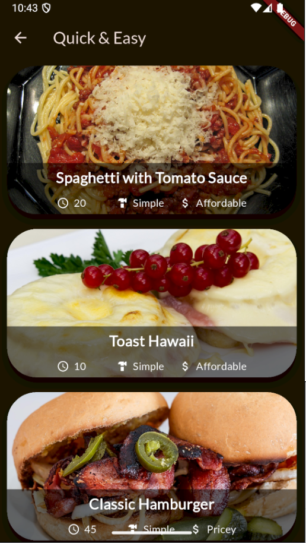
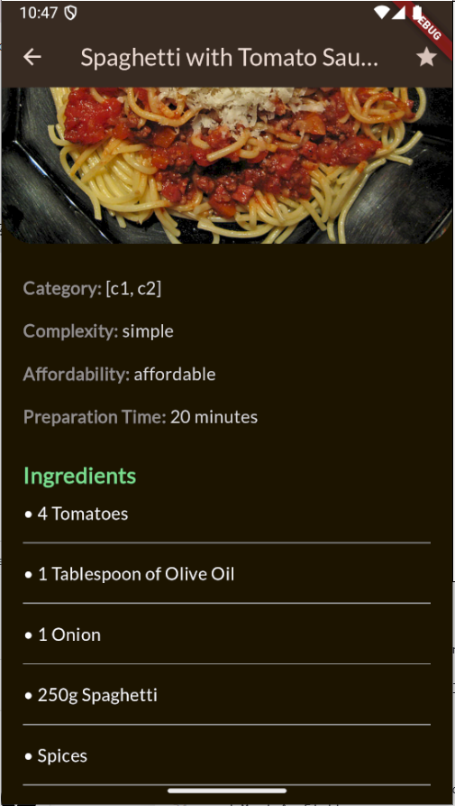
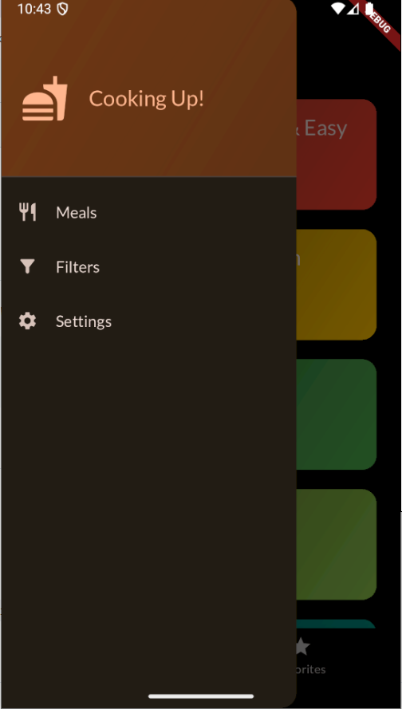

# 🍽️ MealsApp — Flutter Meals Browser

[](https://github.com/NourMontacer01/MealsAppFlutter/actions/workflows/flutter.yml)


A multi-screen Flutter app to **browse meals by category, filter them by diet** and read full recipes with ingredients and steps.
Favorites and filters are managed with **Riverpod**, and the UI uses Material 3 with a dark theme and animations.

<p align="center">
  
  
  
  
</p>

## ✨ Features

- **10 categories** (Italian, Quick & Easy, Asian…) in an animated grid
- **Meal list** per category with duration, complexity and price level
- **Recipe details**: photo with a `Hero` transition, ingredients and steps
- **Diet filters**: gluten-free, lactose-free, vegetarian, vegan — combinable
- **Favorites** tab, toggled with an animated star and a confirmation snackbar
- Side drawer to switch between meals and filters

## 🧱 Architecture

```
lib/
├── data/dummy_data.dart        # Categories and meals
├── models/                     # Meal, Category
├── providers/
│   ├── meals_provider.dart     # All meals
│   ├── filter_provider.dart    # Active filters + filtered meals (derived provider)
│   └── favorite_provider.dart  # Favorite meals (StateNotifier)
├── screens/                    # Tabs, categories, meals, meal details, filters
└── widgets/                    # Grid items, meal cards, drawer
```

`filtredMealsProvider` watches both the meals and the active filters, so every screen that
reads it updates automatically when a filter changes.

## 🚀 Getting started

Requirements: [Flutter](https://docs.flutter.dev/get-started/install) 3.29+ (Dart 3.7+).

```sh
git clone https://github.com/NourMontacer01/MealsAppFlutter.git
cd MealsAppFlutter
flutter pub get
flutter run
```

## 🧪 Tests

```sh
flutter test
```

Covers the filtering logic (single, combined and removed filters), favorites, the home tab and the
empty Favorites tab. GitHub Actions runs `flutter analyze` and the tests on every push.

## 🔮 Ideas for later

- Search meals by name or ingredient
- Persist favorites and filters between launches
- Load meals from an API instead of local data
- Light / dark theme switch

## 🤝 Contributing

Issues and pull requests are welcome.
